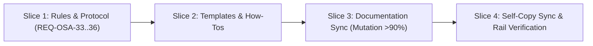

# Tasks

## 1. Dependency DAG

## 2. Streams & Worktrees
| Stream | Worktree Path | Branch | Prerequisite |
| :--- | :--- | :--- | :--- |
| Main Stream | in-tree | `feat/w5-1-agent-hardening` | Gate 4 |

## 3. Slices

### Slice 1: Rules & Workflow Protocol
- [x] 3.1 Update `rules/AGENTS.md` with Contract Scaffolding Rail, Understand-or-Delete Comprehension Invariant, and mutation threshold > 90% (`REQ-OSA-33`, `REQ-OSA-34`, `REQ-OSA-36`) Evidence: `sh tests/test_lint.sh` -> 28 passed, 0 failed
- [x] 3.2 Update `rules/WORKFLOW.md` with Optional Candidate Bake-Off pattern in Rule 3, Gate 6 Comprehension Verification, and mutation threshold > 90% (`REQ-OSA-34`, `REQ-OSA-35`, `REQ-OSA-36`) Evidence: `sh tests/test_lint.sh` -> 28 passed, 0 failed

### Slice 2: Templates & How-To Guide
- [x] 3.3 Update `schemas/spec-rails/templates/tasks.md` and `schemas/spec-rails/schema.yaml` with contract scaffolding checklist, Gate 6 comprehension sign-off, and mutation > 90% Evidence: `sh tests/test_schema.sh` -> 30 passed, 0 failed
- [x] 3.4 Update `docs/how-tos/03-parallel-worktrees-multi-agent.md` with Section 6 Optional Candidate Bake-Off recipe Evidence: `sh tests/check_hygiene.sh` -> passed

### Slice 3: Documentation Sync (Mutation > 90% & Rules)
- [x] 3.5 Update `README.md`, `docs/WIKI.md`, `docs/WAY_OF_WORKING.md`, `docs/DESIGN.md`, and `docs/how-tos/01..05` to reflect > 90% mutation kill score, new agent rules, and suggested watch link Evidence: `sh tests/check_hygiene.sh` -> passed

### Slice 4: Self-Copy Sync & Rail Verification
- [x] 3.6 Trace `REQ-OSA-33..36` in tests and sync installed copies (`openspec/spec-rails/`, `openspec/schemas/spec-rails/`) Evidence: `sh tests/test_selfcopy.sh && sh tests/bdd/test_bdd.sh` -> 19 passed, 0 failed
- [x] 3.7 Run test rails and verification Evidence: `sh bin/spec-rails-verify` -> ok: REQ-OSA-33..36 covered, all checks passed

## 4. Integration & Rebase Plan
- [ ] 4.1 Rebase onto target branch, verify full test suite, and archive change

## Review Gate
- [x] **Gate 4 Approval**: Tasks breakdown approved by human before writing test code.
