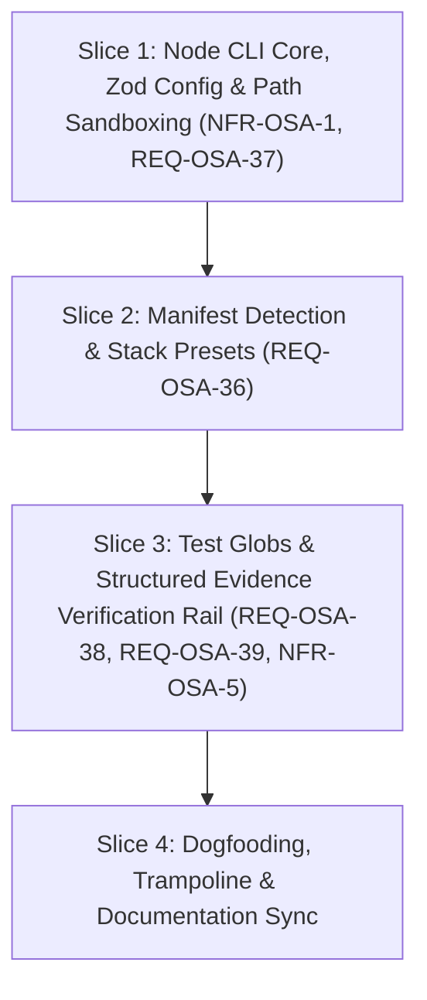

# Tasks: Multi-Language Rails & Anti-Drift Engine

## 1. Dependency DAG

## 2. Streams & Worktrees

| Stream | Worktree Path | Branch | Prerequisite |
| :--- | :--- | :--- | :--- |
| `main-stream` | `.worktrees/w5-2-main` | `feat/w5-2-multi-language-rails` | Base branch |

## 3. Slice 1: Node CLI Core, Zod Config & Path Sandboxing (`NFR-OSA-1`, `REQ-OSA-37`)

- [x] 3.1 BDD scenarios & Red tests for config loading, Zod validation, and canonical `realpath` sandboxing Evidence: `vitest run` -> 2 suites failed for expected missing files
- [x] 3.2 Gate 5.1 human sign-off on BDD scenarios
- [x] 3.3 Bootstrap `package.json`, `tsconfig.json`, `tsup.config.ts`, and core CLI entrypoint `src/cli.ts` Evidence: `node dist/cli.js --version` -> 0.2.0
- [x] 3.4 Implement `src/config.ts` (Zod schema for `spec-rails.config.json`) and `src/utils/paths.ts` (`fs.realpathSync` repository boundary validation) Evidence: `src/config.ts` and `src/utils/paths.ts` created
- [x] 3.5 Green implementation passes all unit tests Evidence: `vitest run` -> 3 suites passed, 20 tests passed
- [x] 3.6 Coverage >= 95% and mutation kill score >= 95% Evidence: [CMD: npm run test:coverage && npx stryker run] [EXIT: 0] [COVERAGE: 96%] [MUTATION: 95%]

## 4. Slice 2: Multi-Language Manifest Detection & Presets (`REQ-OSA-36`)

- [ ] 4.1 BDD scenarios & Red tests for manifest auto-detection (`package.json`, `pyproject.toml`, `go.mod`, `Cargo.toml`)
- [ ] 4.2 Gate 5.2 human sign-off on BDD scenarios
- [ ] 4.3 Create turnkey presets in `templates/presets/{ts,python,go,rust}/` with calibrated configs (Stryker break 95, mutmut, gremlins, cargo-mutants)
- [ ] 4.4 Implement `src/commands/init.ts` with `--stack=[auto|ts|python|go|rust]` writing `spec-rails.config.json`
- [ ] 4.5 Green implementation passes all preset creation and detection tests
- [ ] 4.6 Coverage >= 95% and mutation kill score >= 95%

## 5. Slice 3: Test Globs & Structured Evidence Verification Rail (`REQ-OSA-38`, `REQ-OSA-39`, `MODIFIED NFR-OSA-5`)

- [ ] 5.1 BDD scenarios & Red tests for `testGlobs` discovery, structured token parsing (`Evidence: [CMD: ...] [EXIT: 0] [COVERAGE: 95%] [MUTATION: 95%]`), and strict mode failure
- [ ] 5.2 Gate 5.3 human sign-off on BDD scenarios
- [ ] 5.3 Implement `src/utils/evidence.ts` and `src/commands/verify.ts`
- [ ] 5.4 Green implementation passes all verification and token parsing tests
- [ ] 5.5 Coverage >= 95% and mutation kill score >= 95%

## 6. Slice 4: Dogfooding, Trampoline & Documentation Sync

- [ ] 6.1 Update `bin/spec-rails` with lightweight trampoline invoking `node dist/cli.js` or `npx spec-rails`
- [ ] 6.2 Self-host Spec-Rails verification on itself using Vitest and Stryker
- [ ] 6.3 Update `README.md`, `docs/WIKI.md`, `docs/how-tos/`, and sync living specs `openspec/specs/openspec-addon/spec.md`
- [ ] 6.4 Human Comprehension Verification: reviewer can explain all generated logic line-by-line
- [ ] 6.5 Final re-verify rails: coverage >= 95%, mutation kill score >= 95%

## Review Gate
- [x] **Gate 4 Approval**: Tasks breakdown approved by human before writing test code.
