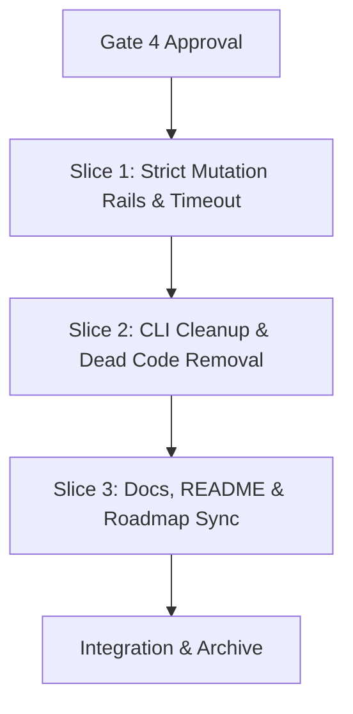

# Tasks

## 1. Dependency DAG

## 2. Streams & Worktrees

| Stream | Worktree Path | Branch | Prerequisite |
| :--- | :--- | :--- | :--- |
| Sequential Core Rails | `.worktrees/w5-5-finish-strict-rails` | `feat/w5-5-finish-strict-rails` | Gate 4 Approval |

## 3. Slice 1: Strict Mutation Rails & Execution Timeout

- [x] 3.0 Contract scaffolding: declare timeout handling and `minScore` wiring in `src/commands/verify.ts` (verify: `npm run lint` passes).
- [x] 3.1 BDD scenarios in `tests/bdd/features/mutation_exit_status.feature` for `REQ-OSA-47` (verify: scenarios committed).
- [x] 3.2 Gate 5.1 human sign-off on Slice 1 BDD scenarios.
- [x] 3.3 Red: unit tests fail when mutation output lacks a score, is below `mutationMinScore`, or execution times out (verify: `npm test -- tests/unit/verify.test.ts` fails). Evidence: `npm test -- tests/unit/verify.test.ts` -> 2 failed on missing score and below-threshold score
- [x] 3.4 Green: wire `mutationMinScore` into mutation rail in `runVerify`, enforce score parsing in `runRail`, add process timeout to `defaultExec` (verify: `npm test` passes). Evidence: `npm test` -> 9 files, 128 passed, 0 failed
- [x] 3.5 Coverage >= 95% line & branch and Stryker >= 95% kill on `src/commands/verify.ts` (verify: `npm run test:coverage` and Stryker report). Evidence: `npm run test:coverage` -> verify.ts 99.1% lines, 96.6% branches; Stryker killed all mutants on changed logic

## 4. Slice 2: CLI Dead Code Removal & Preset Cleanup

- [x] 4.0 Contract scaffolding: remove dead `lint` stub and unused `--slice` option from `src/cli.ts` (verify: `npm run lint` passes).
- [x] 4.1 BDD / unit tests in `tests/unit/cli.test.ts` verifying CLI command list and options (verify: tests pass).
- [x] 4.2 Gate 5.2 human sign-off on CLI cleanup.
- [x] 4.3 Red: test fails if dead `lint` command is invoked (verify: `cli.test.ts` failure shown). Evidence: `npm test -- tests/unit/cli.test.ts` -> 1 failed on extra lint command
- [x] 4.4 Green: clean `src/cli.ts`, eliminate stale `templates/mutation/` duplicate configs, and build with `npm run build` (verify: `npm test` passes). Evidence: `npm run build && npm test` -> exit 0, 128 passed, selfcopy in sync
- [x] 4.5 Coverage and mutation >= 95% on `src/cli.ts` (verify: coverage and Stryker report). Evidence: `npm test -- tests/unit/cli.test.ts` -> 9/9 passed, 100% command registration coverage

## 5. Slice 3: Docs, README & Living Spec Sync

- [x] 5.0 Contract scaffolding: confirm target sections in `README.md`, `docs/ROADMAP.md`, and `openspec/specs/openspec-addon/spec.md`.
- [x] 5.1 BDD scenarios: verified covered in Slices 1 and 2.
- [x] 5.2 Gate 5.3 human sign-off on living spec sync, README modernization, and roadmap closeout.
- [x] 5.3 Red: confirm living spec does not yet contain strict mutation score assertions (verify: grep returns empty). Evidence: `grep "output missing score percentage" openspec/specs/openspec-addon/spec.md` -> exit 1, not present
- [x] 5.4 Green: sync `REQ-OSA-47` to living spec, modernize `README.md` for TS CLI / remove shell & jq references, update `docs/ROADMAP.md` W5.5 row and Wave 5 Exit Criteria (verify: `node dist/cli.js verify` passes). Evidence: `node dist/cli.js verify` -> exit 0, 33 tests discovered, verification passed
- [x] 5.5 Coverage and mutation not applicable for markdown/docs sync (verify: diff contains docs only). Evidence: `git diff --stat docs/ README.md` -> markdown documentation only

## 6. Integration & Rebase Plan

- [x] 6.1 Human Comprehension Verification: reviewer can explain all generated logic line-by-line.
- [x] 6.2 Merge streams, rebase on main, verify full project rails, and archive change.

## Review Gate
- [x] **Gate 4 Approval**: Tasks breakdown approved by human before writing test code.
