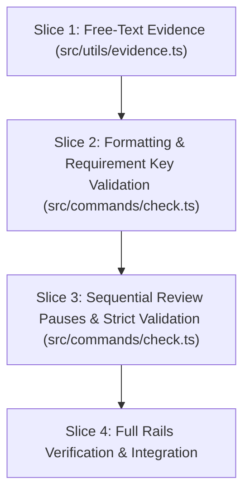

# Tasks

## 1. Dependency DAG

## 2. Streams & Worktrees

| Stream | Worktree Path | Branch | Prerequisite |
| :--- | :--- | :--- | :--- |
| Core Stream | `.worktrees/w6-2-spec-quality-gate` | `feat/w6-2-spec-quality-gate` | None (Single Stream) |

## 3. Slice 1: Relax Evidence Parsing to Free-Text Notes

- [ ] 3.0 Contract scaffolding: update `ValidationOptions` in `src/utils/evidence.ts` for free-text mode
- [ ] 3.1 Red unit tests: add test cases in `tests/unit/evidence.test.ts` expecting `Evidence: <free-text>` to pass and empty note to fail (verify: `npm test` fails)
- [ ] 3.2 Green implementation: update `validateEvidenceToken` in `src/utils/evidence.ts` to accept non-empty free-text notes (verify: `npm test` passes)
- [ ] 3.3 Coverage >= 95% and mutation >= 95% kill on `src/utils/evidence.ts` (verify: vitest coverage)

## 4. Slice 2: Artifact Hygiene and Requirement Key Validation

- [ ] 4.0 Contract scaffolding: define `checkArtifactHygiene` and `checkRequirementKeys` signatures in `src/commands/check.ts`
- [ ] 4.1 Red unit tests: add tests in `tests/unit/check.test.ts` for trailing whitespace, missing EOF newlines, and unkeyed delta requirements (verify: `npm test` fails)
- [ ] 4.2 Green implementation: implement hygiene and regex requirement key verification in `src/commands/check.ts` (verify: `npm test` passes)
- [ ] 4.3 Coverage >= 95% and mutation >= 95% kill on hygiene helpers (verify: vitest coverage)

## 5. Slice 3: Sequential Review Pauses and Strict Validation

- [ ] 5.0 Contract scaffolding: define sequential gate order mapping and downstream blocked checks in `src/commands/check.ts`
- [ ] 5.1 Red unit tests: add tests in `tests/unit/check.test.ts` asserting Gate 0 unticked blocks `proposal.md`, Gate 1 unticked blocks `design.md`/`specs/`, Gate 2 unticked blocks `tasks.md`, and Gate 3 unticked blocks code diffs (verify: `npm test` fails)
- [ ] 5.2 Green implementation: enforce sequential gate blocking and execute `openspec validate <change> --strict` in `src/commands/check.ts` (verify: `npm test` passes)
- [ ] 5.3 Coverage >= 95% and mutation >= 95% kill on `src/commands/check.ts` (verify: vitest coverage)

## 6. Integration & Rebase Plan

- [ ] 6.1 Run full test suite, lint, and build (`npm test`, `npm run lint`, `npm run build`)
- [ ] 6.2 Verify gates and audit with `node dist/cli.js check` and `node dist/cli.js verify`
- [ ] 6.3 Archive change with `openspec archive w6-2-spec-quality-gate` and sync living spec

## Review Gate
- [x] **Gate 3 Approval**: Tasks breakdown approved by human before writing test code.
