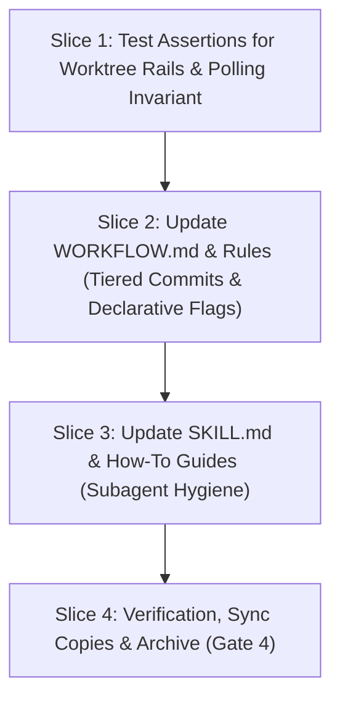

# Tasks: Worktree Execution Rails & Subagent Hygiene (W6.5)

## 1. Dependency DAG

## 2. Streams & Worktrees

| Stream | Worktree Path | Branch | Prerequisite |
| :--- | :--- | :--- | :--- |
| Stream 1 | `.worktrees/w6-5-worktree-execution-rails` | `feat/w6-5-worktree-execution-rails` | Gate 3 Approval |

## 3. Slice 1: Test Assertions for Worktree Rails & Polling Invariant

- [ ] 3.0 Contract scaffolding: declare test skeletons in `tests/unit/hygiene.test.ts` for REQ-OSA-51, REQ-OSA-52, REQ-OSA-53
- [ ] 3.1 Red unit tests fail for expected reason (verify: test failure observed; append trailing evidence when ticking)
- [ ] 3.2 Green implementation: verify doc parsing logic works once text is in place (verify: `npm test`; append trailing evidence when ticking)
- [ ] 3.3 Coverage >= 95% and mutation >= 95% kill (verify: reports; append trailing evidence when ticking)

## 4. Slice 2: Update WORKFLOW.md & Rules (Tiered Commits & Declarative Flags)

- [ ] 4.0 Contract scaffolding: outline changes to Rule 3 and Rule 4
- [ ] 4.1 Red check: identify all rules sections referencing commit verification and command invocation (verify: grep output; append trailing evidence when ticking)
- [ ] 4.2 Green implementation: update `rules/WORKFLOW.md`, `rules/AGENTS.md`, and sync to `openspec/spec-rails/` (verify: `npm test`; append trailing evidence when ticking)
- [ ] 4.3 Coverage check: hygiene and selfcopy tests pass (verify: `npm test`; append trailing evidence when ticking)

## 5. Slice 3: Update SKILL.md & How-To Guides (Subagent Hygiene)

- [ ] 5.0 Contract scaffolding: outline subagent zero-polling invariant and declarative command shapes in `skills/spec-rails/SKILL.md`
- [ ] 5.1 Red check: assert missing guidelines in skill (verify: test failure or grep; append trailing evidence when ticking)
- [ ] 5.2 Green implementation: update `skills/spec-rails/SKILL.md`, `.agents/skills/spec-rails/SKILL.md`, and `docs/how-tos/03-parallel-worktrees-multi-agent.md` (verify: `npm test`; append trailing evidence when ticking)
- [ ] 5.3 Verification: full check and verify pass cleanly (verify: `node dist/cli.js check && node dist/cli.js verify`; append trailing evidence when ticking)

## 6. Integration & Rebase Plan
- [ ] 6.1 Human Comprehension Verification: reviewer can explain all changes line-by-line
- [ ] 6.2 Merge to main via `--ff-only`, run `openspec archive w6-5-worktree-execution-rails --yes`, push to `origin/main`

## Review Gate
- [x] **Gate 3 Approval**: Tasks breakdown approved by human before writing test code.
