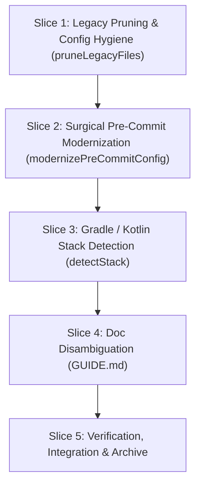

# Tasks

## 1. Dependency DAG

## 2. Streams & Worktrees

| Stream | Worktree Path | Branch | Prerequisite |
| :--- | :--- | :--- | :--- |
| Core Stream | `.worktrees/w7-1-init-upgrade-hygiene` | `feat/w7-1-init-upgrade-hygiene` | None (Single Stream) |

## 3. Slice 1: Legacy Pruning & Config Hygiene

- [ ] 3.0 Contract scaffolding: declare `pruneLegacyFiles` signature in `src/commands/init.ts` and stop copying `rails.conf`
- [ ] 3.1 Red unit tests: assert `initProject` prunes `spec-rails-check`, `spec-rails-verify`, and `rails.conf` when present in target repo (verify: `npm test` fails)
- [ ] 3.2 Green implementation: implement `pruneLegacyFiles` and exclude `rails.conf` during asset copy (verify: `npm test` passes)
- [ ] 3.3 Coverage >= 95% and mutation >= 95% kill on pruning paths (verify: vitest coverage)

## 4. Slice 2: Surgical Pre-Commit Modernization

- [ ] 4.0 Contract scaffolding: declare `modernizePreCommitConfig` signature in `src/commands/init.ts`
- [ ] 4.1 Red unit tests: test with mixed pre-commit YAML asserting `spec-rails-check` updated to `npx --no-install spec-rails check`, and `check-lgtm-directives` & `spec-rails-verify` removed while custom hooks are preserved (verify: `npm test` fails)
- [ ] 4.2 Green implementation: implement `modernizePreCommitConfig` and wire into `initProject` when `.pre-commit-config.yaml` exists (verify: `npm test` passes)
- [ ] 4.3 Coverage >= 95% and mutation >= 95% kill on YAML modernization (verify: vitest coverage)

## 5. Slice 3: Gradle / Kotlin Stack Detection

- [ ] 5.0 Contract scaffolding: add `"gradle"` to `Stack` union in `src/config.ts` and update `getStackMeta`
- [ ] 5.1 Red unit tests: assert `detectStack` returns `"gradle"` on `build.gradle.kts`, `build.gradle`, and `gradlew`; tests `./gradlew test` vs `make test` fallback (verify: `npm test` fails)
- [ ] 5.2 Green implementation: implement Gradle stack detection and command resolution (verify: `npm test` passes)
- [ ] 5.3 Coverage >= 95% and mutation >= 95% kill on stack detection (verify: vitest coverage)

## 6. Slice 4: Doc Disambiguation

- [ ] 6.0 Contract scaffolding: update `scaffoldDeveloperGuide` to emit `docs/spec-rails/GUIDE.md`
- [ ] 6.1 Red unit tests: assert `docs/spec-rails/GUIDE.md` is created and `WORKFLOW.md` is not scaffolded in `docs/` (verify: `npm test` fails)
- [ ] 6.2 Green implementation: implement `docs/spec-rails/GUIDE.md` generation (verify: `npm test` passes)
- [ ] 6.3 Coverage >= 95% on doc scaffolding paths (verify: vitest coverage)

## 7. Integration & Rebase Plan

- [ ] 7.1 Full test suite, lint, and build (`npm test`, `npm run lint`, `npm run build`)
- [ ] 7.2 Run gates with `node dist/cli.js check` and `node dist/cli.js verify`
- [ ] 7.3 Dry run on `~/Workbench/enclave` to verify 100% clean in-place upgrade with zero orphans or duplicates
- [ ] 7.4 Archive change with `openspec archive w7-1-init-upgrade-hygiene` and sync living spec

## Review Gate
- [x] **Gate 3 Approval**: Tasks breakdown approved by human before writing test code.
